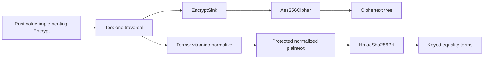

# Vitamin C 0.6: shared foundations for secure software

*Draft · Dan Draper · 17 October 2026*

Open source libraries have long been the foundation of modern software. As coding agents take on more of the work of building applications, the security of those shared foundations matters even more. Developers and agents alike need libraries whose behavior is well understood and whose interfaces make them hard to misuse.

Building secure software, particularly cryptography, takes sustained effort and scrutiny. A function can encrypt and decrypt correctly while leaking a key through debug output, leaving plaintext in freed memory or accepting ciphertext in the wrong context. Establishing confidence in that code requires careful design, testing, review and a clear account of what it guarantees.

Writing that code from scratch in every project repeats the work. Assembling existing primitives also leaves important questions about how their assumptions fit together. Shared libraries give us somewhere to concentrate that effort: implementations that can be examined, tested and improved, with fixes that benefit the applications using them.

That is the purpose of Vitamin C: cryptography and security building blocks for Rust, designed around misuse resistance, extensive testing and expert scrutiny. We want developers to be able to reuse both the code and the work that goes into establishing confidence in it. Vitamin C is [open source under the MIT license](https://github.com/cipherstash/vitaminc/blob/vitaminc-v0.6.0/LICENSE), freely available to use, inspect, modify and build on.

[Version 0.6 is available now](https://github.com/cipherstash/vitaminc/releases/tag/vitaminc-v0.6.0). It brings encryption, language bindings and index normalization onto a shared data model. This is a substantial step toward that goal: more of the rules for handling sensitive values live in one place, where they can be tested and reviewed together.

The starting point is misuse resistance: making useful security properties part of the interfaces you write against. `Protected<T>` wipes its contents when dropped, redacts them in debug output and makes access to the underlying value explicit. The encryption library supplies AES-256-GCM with automatic random nonce generation and support for associated data, so an application can bind a ciphertext to a tenant, record or field. Structured pseudorandom functions provide keyed, context-specific outputs for uses such as equality indexes. These pieces share conventions for handling protected values and context.

Testing that foundation means checking more than successful round trips. Shared conformance vectors check agreement across Rust, Node and Go. [Known-answer vectors](https://github.com/cipherstash/vitaminc/blob/vitaminc-v0.6.0/packages/hmac/tests/normalized_equality.rs) check normalized HMAC outputs against independently calculated results. Mutation testing checks whether tests catch deliberate code changes, and differential fuzzing looks for disagreements between implementations. Formal checking is targeted: [Kani harnesses](https://github.com/cipherstash/vitaminc/blob/vitaminc-v0.6.0/packages/protected/src/locked/proofs.rs) cover bounded layout and wiping properties of `Locked` storage. The [test corpus](https://github.com/cipherstash/vitaminc/blob/vitaminc-v0.6.0/testdata/README.md) and [verification workflows](https://github.com/cipherstash/vitaminc/tree/vitaminc-v0.6.0/.github/workflows) are public alongside the implementation.

You can adopt them separately. A service handling API tokens might only need protected memory and timing-safe comparisons. An application encrypting fields can use `vitaminc-encrypt`. Developers building encrypted search can combine the data model, normalization and keyed derivation. The `vitaminc` umbrella crate exposes capabilities through feature flags, and individual crates are available directly. [Source and crate overview](https://github.com/cipherstash/vitaminc/tree/vitaminc-v0.6.0).

The largest change in 0.6 is how a value reaches those operations. Previously, encryption reduced scalar values to bytes before another operation could use their type information. Producing equality terms alongside ciphertext meant constructing an intermediate value tree or walking the source again. Each cipher also implemented its own container rules, including how map entries were bound to their field names.

Now a type describes itself through `Encrypt`, and a consumer called a `Sink` decides what to do with that description. A sink can prepare encryption, collect normalized index inputs or build a transport frame. `Tee` lets two sinks consume the same traversal. The cipher itself has two jobs: seal a leaf and open a leaf. Shared code handles the containers. [The design decision](https://github.com/cipherstash/vitaminc/blob/vitaminc-v0.6.0/docs/adr/0001-describe-plaintext-once-and-consume-it-with-sinks.md) explains the reasoning.



That separation also helps remote encryption backends. The new `AsyncCipher` interface has batch hooks that receive all of a document's leaves, allowing a provider with a batch API to seal or open them in one request. It comes with a deliberate memory trade-off: the planned plaintext leaves coexist in protected buffers before sealing. This is a document-oriented design; memory use grows with the plaintext being processed.

Keeping type information is especially useful when an encrypted value needs to be searchable. A JavaScript `BigInt` might arrive as an eight-bit integer, while a Go service represents the same number as an `int64`. If each representation produces a different index input, a query can miss data that is numerically equal.

The new `vitaminc-normalize` crate defines the equality rules before cryptography is applied. With the same PRF key and context, the resulting terms behave like this:

| Values being compared | Normalized equality terms |
| --- | --- |
| JavaScript `34n` and Go `int64(34)` | Match across integer widths |
| Decimal `1.0` and decimal `1.00` | Match across scales |
| `é` and `e` followed by a combining acute accent | Match through Unicode NFC normalization |
| JavaScript `34` and Go `int64(34)` | Stay distinct: float and integer |
| A date and the integer used to encode its day count | Stay distinct: different logical types |

Text equality preserves case and accents. Timestamp index terms use microsecond precision; the encrypted value can retain finer precision. These are explicit index semantics, recorded under versioned domain labels. Changing an encoding requires a new label. [Normalization rules](https://github.com/cipherstash/vitaminc/blob/vitaminc-v0.6.0/packages/normalize/README.md).

Normalization produces protected plaintext inputs. The PRF turns those inputs into keyed terms suitable for an equality index. For a document, each normalized input also carries its field path so an application can route it to the appropriate index and derivation context.

Here is a complete example using the umbrella crate. Add this dependency to a Rust project's `Cargo.toml`, then put the Rust example in `src/main.rs` and run `cargo run`:

```toml
[dependencies]
vitaminc = { version = "0.6.0", features = ["encrypt", "normalize", "hmac", "random"] }
```

```rust
use vitaminc::{
    aead::{Int, Physical},
    encrypt::{decrypt, Aes256Cipher, Key},
    hmac::HmacSha256Prf,
    normalize::encrypt_with_terms,
    prf::{EqualityTerm, PrfKeyInit, PrfValue},
    protected::Protected,
    random::{Generatable, SafeRand},
};

fn main() -> Result<(), Box<dyn std::error::Error>> {
    let mut rng = SafeRand::from_entropy()?;
    let cipher = Aes256Cipher::new(&Key::random(&mut rng)?)?;
    let prf = HmacSha256Prf::new(Protected::<[u8; 32]>::random(&mut rng)?);
    let context = ("tenant-7", "orders/quantity");

    let quantity = Protected::new(34i64);
    let (ciphertext, terms) = encrypt_with_terms(quantity, &cipher, context)?;
    let stored_term = (&terms[0].normalized)
        .prf_with_context(&prf, context)
        .into_result()?;

    // A query using a narrower integer finds the same value.
    let query_term = EqualityTerm::new(None, Physical::Int(Int::I8(34)))
        .prf_with_context(&prf, context)
        .into_result()?;
    assert_eq!(stored_term, query_term);

    let _quantity: Protected<i64> = decrypt(&cipher, ciphertext, context)?;
    Ok(())
}
```

This generates separate encryption and indexing keys for the example, encrypts the quantity and derives an equality term. A query expressed at a different integer width produces the same term, and decryption returns a protected value. An application would persist its ciphertext and keyed term, and manage the keys separately so later requests can decrypt and query the data. The local HMAC backend's `into_result()` completes synchronously; its output also supports awaiting.

Ordering has its own requirements. The new `vitaminc-ore` crate supplies typed encodings and interfaces beneath order-revealing encryption schemes. A column declares a target type and context. Values that fit are encoded consistently, and values outside the target's range are refused. Concrete encryption schemes are supplied by separate crates, including `ore-rs` and `cllw-ore`.

The distinction between equality and ordering is intentional. Text order terms fold case and accents, so `École` and `ecole` share an order position while retaining different equality terms. Indexing also exposes information: an equality index reveals repeated values, and an order index reveals relative order. Applications choose those capabilities and their associated leakage. [Order terms and scheme interfaces](https://github.com/cipherstash/vitaminc/blob/vitaminc-v0.6.0/packages/ore/README.md).

The shared model reaches the language boundary too. Rust gains broader scalar support, including optional date, timestamp, decimal and UUID integrations. The Node binding layer can walk live JavaScript values directly, supports `Date`, and provides wrappers for values JavaScript cannot represent natively. The experimental Go binding runs the Rust implementation through WebAssembly with a pure Go runtime. The Node crate is a building block for addons, and the Go binding remains a spike with an unstable API. [Node binding](https://github.com/cipherstash/vitaminc/blob/vitaminc-v0.6.0/packages/aead-napi/README.md), [Go binding status](https://github.com/cipherstash/vitaminc/blob/vitaminc-v0.6.0/bindings/go/README.md).

There are security fixes alongside the new interfaces. Failed authentication now wipes the working decryption buffer. The Node layer hardens property reads and writes against prototype pollution, and keys use dedicated wrapping methods so a caller-supplied encryption sink cannot obtain their bytes. The release notes describe these changes in [AEAD](https://github.com/cipherstash/vitaminc/releases/tag/vitaminc-aead-v0.6.0), [Node](https://github.com/cipherstash/vitaminc/releases/tag/vitaminc-aead-napi-v0.6.0) and [encryption](https://github.com/cipherstash/vitaminc/releases/tag/vitaminc-encrypt-v0.6.0).

Vitamin C is still pre-1.0, and for existing users, **0.6 is a breaking upgrade**. New ciphertext uses wire version 2. Data written through 0.5's Rust `Encrypt` trait or derive needs to be decrypted with 0.5 and encrypted again with 0.6. Previously tagged `Value`-path leaves have an explicit compatibility reader; its scope and the additional context and transport changes are covered in the [migration notes](https://github.com/cipherstash/vitaminc/blob/vitaminc-v0.6.0/packages/aead/CHANGELOG.md). The crates require Rust 1.88 or later, with Rust 1.94.1 required for the AWS KMS integration.

The structured encryption contract also matters when choosing a representation: map keys and container structure remain visible, and sequence order and length are not authenticated. Applications that need to authenticate sequence positions or counts must bind them explicitly, for example through map keys and associated data. [Data model and authentication rules](https://github.com/cipherstash/vitaminc/blob/vitaminc-v0.6.0/packages/aead/README.md).

Start with the [0.6 API documentation](https://docs.rs/vitaminc/0.6.0/vitaminc/) or the crate that fits your application. The source and tests are available for you to inspect and build on. If a type, language boundary or index requirement is awkward to express, [open an issue](https://github.com/cipherstash/vitaminc/issues) with that case. Each concrete example helps us improve the building blocks that other applications will reuse.
